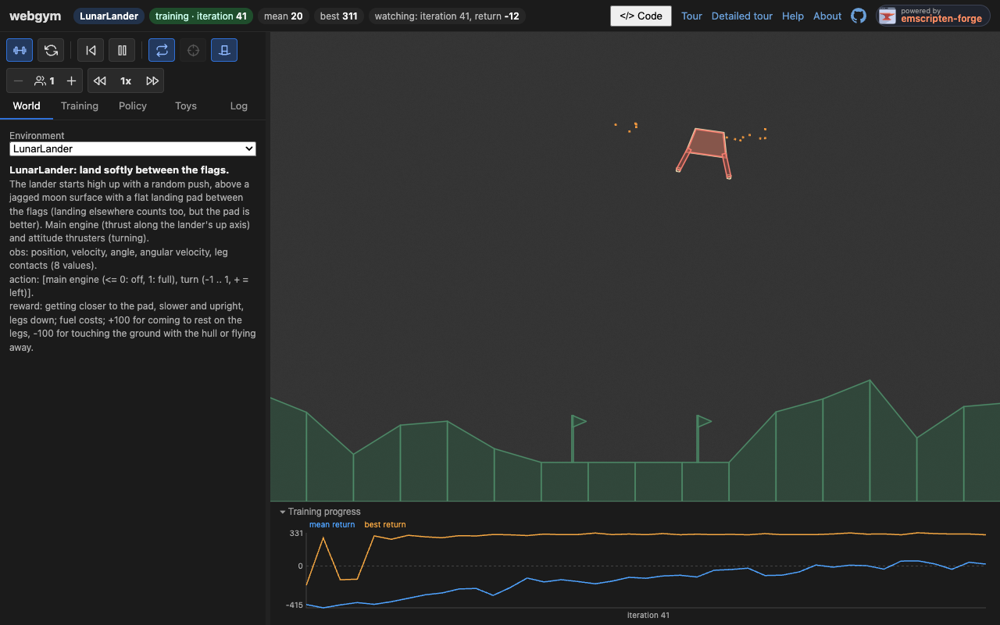
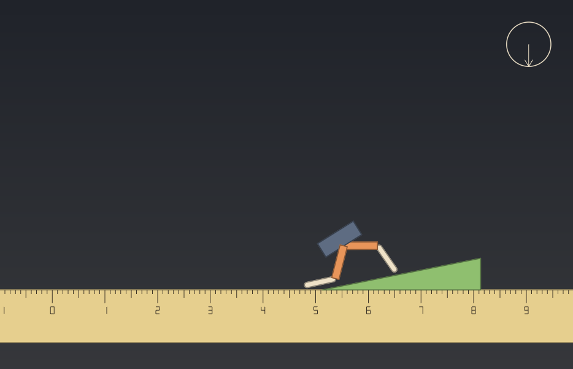
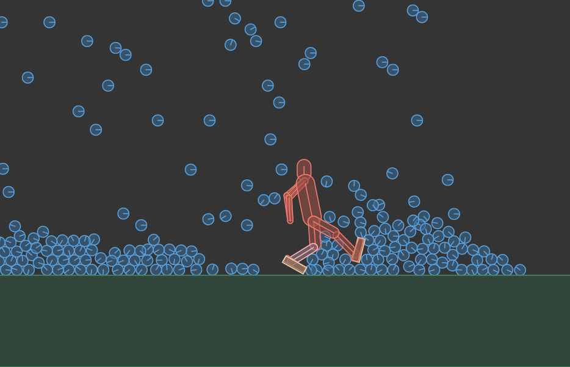
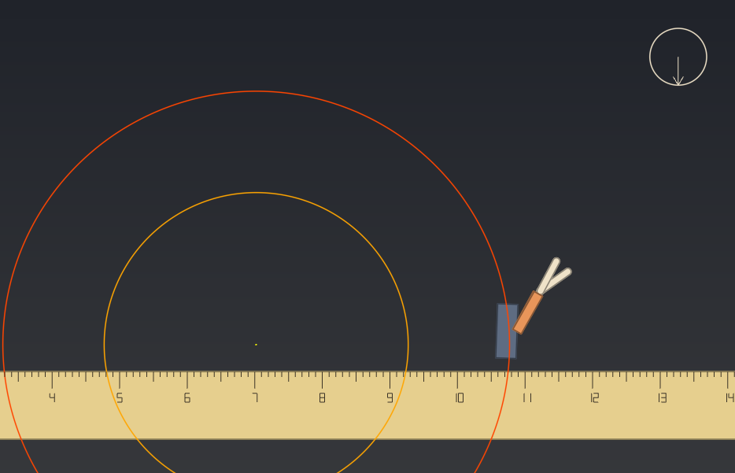
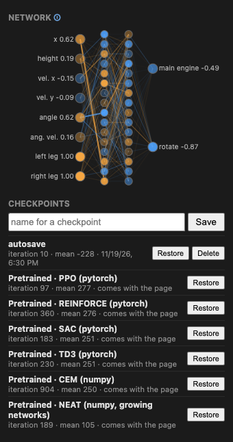

# webgym

**Reinforcement learning, live in your browser.** Agents (a cart balancing a pole, a lunar
lander, walkers, a ragdoll, ...) learn by trial and error in a box2d physics world, and you
watch them learn as it happens. Everything runs on your machine: python, numpy, box2d
([pyb2d3](https://github.com/DerThorsten/pyb2d3)) and pytorch, compiled to WebAssembly by
[emscripten-forge](https://emscripten-forge.org) and run with
[pyjs](https://github.com/emscripten-forge/pyjs). No server, nothing to install.

**▶ Try it: [derthorsten.github.io/webgym](https://derthorsten.github.io/webgym/)** ·
[Help page](https://derthorsten.github.io/webgym/help.html)

Gymnasium-like box2d environments with live training, natively and **in the browser**
(Python in WebAssembly via pyjs + emscripten-forge). Watch a population of agents learn,
drag the env around with the mouse.



## What you can do

- **Train live.** Press ▶ (or just pick a world: it starts by itself): a whole population learns at once in one world (the
  leader solid, the others as ghosts), the progress plot below. Pick a time budget (quick /
  medium / long) and each world suggests an algorithm and its settings.
- **Look inside.** The agent's neural network, live: what it sees, how its neurons fire,
  its weights, as it acts.
- **Play with it.** Restore a pretrained run (every world has some, they come with the
  page) and tease it: grab it with the mouse, or use the *Toys*: boxes, balls,
  planks, explosions, ramps, steps, seesaws, rain, wind, moon gravity.
- **Change the code.** Every world and algorithm is a plain python file. Open *Code*
  (a Monaco editor), edit it, press *Apply*: it runs at once, in the browser. Open and save
  files of your machine; your edits are kept in the browser.

| | |
|---|---|
|  |  |
| A ramp in the walker's way (Toys tab) | The ragdoll, walking in the rain |
|  |  |
| An explosion right behind it | The network, live, and the checkpoints |

## Worlds and algorithms

**Worlds** (`webgym/envs/`): CartPole, DoubleCartPole (a second pole on top), LunarLander,
Walker, Crawler (four legs), Ragdoll (a human figure, 11 motor joints), WaterCannon (keep objects in the air with water).

**Algorithms** (`webgym/algos/`):

- numpy: CEM, evolution strategies, NEAT (it grows its own network)
- pytorch (loaded in the background): PPO, A2C, REINFORCE, SAC, TD3, DQN

## How it works

- The same python package `webgym` runs natively (tests, a headless CLI) and in the
  browser.
- In the browser, python runs in Web Workers: one trains, one simulates what you watch and
  draws it with WebGL (PyOpenGL) on an offscreen canvas. More workers can run a share of the
  population, so CEM and ES train several times faster.
- An environment builds **one** agent; webgym puts *n* of them into **one** box2d world
  (they don't collide) and steps them batched with numpy. CartPole runs 24x faster that way
  than in separate worlds.
- The packages come from emscripten-forge, pinned per architecture (wasm64 where the browser
  has memory64, else wasm32), and pyjs caches them (with their bytecode): a second visit
  starts in about a second.

## Your own environment

A world is a short python class. CartPole, the template (`webgym/envs/cartpole.py`,
without its docstring and DQN / time-budget extras):

```python
import numpy as np
import pyb2d3 as b2d

from webgym.core import Env, register_env

MAX_FORCE = 10.0  # N; the cart weighs 1 kg, the pole 0.1 kg (as the classic cart-pole)


@register_env("CartPole")
class CartPole(Env):
    obs_names = ("cart x", "cart velocity", "pole angle", "pole ang. vel.")
    action_names = ("force",)  # actions are always in [-1, 1]
    max_steps = 500
    view_center, view_zoom = (0.0, 1.0), 3.0

    def build_scenery(self):  # once: the static world
        self.ground = self.scenery(b2d.box(3.0, 0.05))

    def build_agent(self, i):  # ONE agent; webgym batches them: self.cart = all carts
        cart = self.body((0, 0.3), b2d.box(0.25, 0.12), density=1 / 0.12)  # (1 kg)
        pole = self.body((0, 0.92), b2d.box(0.025, 0.5), density=2.0)  # (0.1 kg)
        # the rail, with stops at its ends (the episode ends before, at |x| = 2.4)
        self.world.create_prismatic_joint(
            body_a=self.ground, body_b=cart,
            local_frame_a=b2d.transform(p=(0, 0.3)), local_frame_b=b2d.transform(p=(0, 0)),
            enable_limit=True, lower_translation=-2.75, upper_translation=2.75,
        )
        # the hinge: the pole's lower end on the top of the cart
        self.world.create_revolute_joint(
            body_a=cart, body_b=pole,
            local_frame_a=b2d.transform(p=(0, 0.12)), local_frame_b=b2d.transform(p=(0, -0.5)),
        )
        return {"cart": cart, "pole": pole}

    def randomize(self, rng):  # the random start of an episode, all agents at once
        self.cart.linear_velocity = np.column_stack([rng.uniform(-0.1, 0.1, self.n), np.zeros(self.n)])
        self.pole.angular_velocity = rng.uniform(-0.1, 0.1, self.n)

    def act(self, actions):  # (n, 1)
        force = np.column_stack([actions[:, 0] * MAX_FORCE, np.zeros(self.n)])
        self.cart.apply_force_to_center(force, True)

    def observe(self):  # columns, one value per agent
        return [self.cart.position[:, 0], self.cart.linear_velocity[:, 0], self.pole.angle,
                self.pole.angular_velocity]

    def reward(self):  # (reward, done) per agent
        fallen = (np.abs(self.pole.angle) > 0.21) | (np.abs(self.cart.position[:, 0]) > 2.4)
        return np.ones(self.n), fallen
```

Put the file into `webgym/envs/` (or edit one in the browser with *Code*); the comment at
the top of [`webgym/core.py`](webgym/core.py) explains each method step by step, and how to
give an env settings the user can choose.

## Development

```bash
pixi run test                      # python tests
pixi run python -m webgym.cli      # train CartPole headless
pixi run web-dev                   # the page with the vite dev server
pixi run web-build                 # static page in web/dist
pixi run -e web-test web-test      # the page in headless chromium
```

- Pretrained runs: `pixi run -e ml python web/pretrain.py` trains them, `--upload` puts them
  on the GitHub release `pretrained-<version>` (the Pages workflow downloads them),
  `pixi run -e ml python web/check_pretrained.py` checks that they still fit their worlds.
- Help screenshots: `pixi run -e web-test python web/help_shots.py`.
- Every push to `main` is tested, built and deployed to GitHub Pages.

See [CLAUDE.md](CLAUDE.md) for how it is built (envs, algorithms, the browser setup).

## Acknowledgments

- [QuantStack](https://quantstack.net), for the work on emscripten-forge.
- [Bloomberg](https://www.bloomberg.com), for their financial support of emscripten-forge.
- Anutosh Bhat, for bringing pytorch to emscripten-forge.
- [Box2D](https://box2d.org) by Erin Catto;
- [Gymnasium](https://gymnasium.farama.org)
  (Farama Foundation) for the idea and the classic environments.

More (credits, what is what, things to try) on the
[help page](https://derthorsten.github.io/webgym/help.html).
